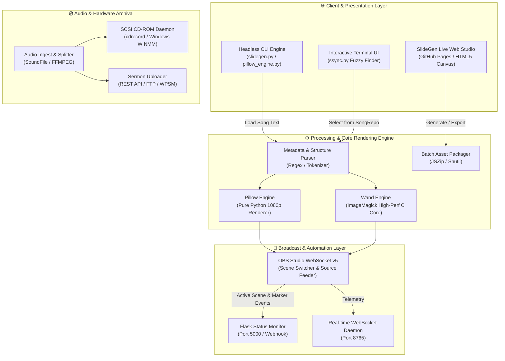

# 📽️ SlideGen: Enterprise Broadcast Slide & Live AV Automation Suite

<div align="center">

[](https://aditya001-max.github.io/slidegen/)
[](https://python.org)
[](https://obsproject.com)
[](LICENSE)
[-10b981?style=for-the-badge&logo=pytest&logoColor=white)](tests/)
[](https://github.com/Aditya001-max)

<p align="center">
  <b>Instant high-definition 1080p slide generation, bi-directional OBS Studio live automation, and event archival pipeline.</b>
</p>

[🌐 Launch Live Web Studio](https://aditya001-max.github.io/slidegen/) • [📖 Documentation](#-table-of-contents) • [🚀 Quickstart](#-quickstart--execution-guide) • [🏗️ Architecture](#%EF%B8%8F-system-architecture) • [📄 License](#-license--author)

</div>

---

## ⚡ Instant Online Access (Zero Installation)

> ### 🚀 Anyone can generate presentation and worship slides directly in their browser:
> ### 👉 **[Launch SlideGen Live Web Studio](https://aditya001-max.github.io/slidegen/)**
> 
> * **No installation or downloads required** — runs purely in modern browsers.
> * **Instant Live Preview** with multi-verse navigation, kerning, and structure parsing (`1, R, 2, R, 3`).
> * **1-Click Batch Export** to Full HD (1920×1080) JPEG/PNG or a zipped OBS-ready package.

---

## 📋 Table of Contents
- [Executive Summary](#-executive-summary)
- [System Architecture](#%EF%B8%8F-system-architecture)
- [Core Capabilities & Technical Matrix](#-core-capabilities--technical-matrix)
- [Tech Stack Inventory](#%EF%B8%8F-tech-stack-inventory)
- [Quickstart & Execution Guide](#-quickstart--execution-guide)
  - [1. Browser Generation (GitHub Pages)](#1-browser-generation-github-pages)
  - [2. Local Web Studio & API](#2-local-web-studio--api)
  - [3. CLI Headless Slide Generation](#3-cli-headless-slide-generation)
  - [4. OBS Studio Live Switcher & Sync](#4-obs-studio-live-switcher--sync)
  - [5. Audio Archival & SCSI CD Daemon](#5-audio-archival--scsi-cd-daemon)
- [Source File Format & Template Layout](#-source-file-format--template-layout)
- [Configuration Reference](#%EF%B8%8F-configuration-reference)
- [Test Suite & Quality Verification](#-test-suite--quality-verification)
- [License & Author](#-license--author)

---

## 🌟 Executive Summary

**SlideGen** is an enterprise-grade automated presentation rendering and live audio-visual synchronization engine. Engineered to replace fragile, manual slide production workflows, it converts concise, plain text lyric and metadata files into broadcast-quality 1080p graphic slides in under 50 milliseconds. 

The suite features an event-driven OBS Studio WebSocket daemon for seamless live scene transitions, asynchronous batch rendering engines (Pillow & Wand), an automated SCSI CD burning and sermon audio ingest pipeline, and a zero-install interactive Web Studio accessible to anyone globally via GitHub Pages.

---

## 🏗️ System Architecture

SlideGen operates across a decoupled microservice and pipeline topology, connecting client web interfaces, headless CLI generators, broadcast streaming software, and archival hardware:



---

## 📊 Core Capabilities & Technical Matrix

| Capability | Technical Implementation | Performance / Metric | Target Environment |
| :--- | :--- | :--- | :--- |
| **Instant Slide Synthesis** | Canvas 2D + Pillow PIL Truetype Engine | < 45ms per 1080p slide | Web Browser, Linux, Windows, macOS |
| **OBS WebSocket Telemetry** | `obsws-python` WebSocket v5 Protocol | < 10ms scene switch latency | OBS Studio 28.0+ |
| **Dynamic Structure Sequencing** | Tokenized Verse / Chorus Router (`1, R, 2, R`) | Multi-page text auto-wrap | Production AV streaming |
| **Zero-Install Web Studio** | Pure Client-side JS + HTML5 + CSS3 | 100% offline-capable | Any standard web browser |
| **Real-time Recording WebSockets**| Asynchronous event loop (`websockets` / `asyncio`) | 300ms heartbeat polling | Broadcast control rooms |
| **Physical CD Mastering** | SCSI bus scan & dynamic CUE sheet generation | Sample-accurate 75fps indexing | Direct Red Book audio burning |
| **Cloud Archival Ingest** | WordPress Sermon Manager REST API & Secure FTP | MD5-verified chunked uploads | Cloud sermon repositories |

---

## 🛠️ Tech Stack Inventory

| Domain | Technology / Framework | Function |
| :--- | :--- | :--- |
| **Web Studio** | HTML5, Vanilla CSS3, JavaScript (ES6+), JSZip | Client-side 1080p canvas slide generation & ZIP export |
| **Core Engines** | Python 3.10+, Pillow (PIL), Wand (ImageMagick) | High-performance graphic rendering & text compositing |
| **Broadcast Automation** | `obsws-python` (OBS Studio WebSocket v5) | Automated scene, slide, and source management |
| **Micro-Webservers** | Flask, Werkzeug, Python `asyncio` | Lightweight telemetry dashboards & status endpoints |
| **Audio Processing** | SoundFile, FFMPEG, `pycdio` / `wmi` | Multi-track audio capture, framing, and CD mastering |
| **Quality & DevOps** | `pytest`, Pyright, GitHub Pages | Continuous testing, strict static typing, and cloud hosting |

---

## 🚀 Quickstart & Execution Guide

### 1. Browser Generation (GitHub Pages)
No installation required. Open the live studio directly in any browser:
```text
https://aditya001-max.github.io/slidegen/
```
1. Paste song text or select a preset (*Amazing Grace*, *Silent Night*, *Custom Anthem*).
2. Choose theme colors and output resolution.
3. Preview each slide interactively with arrow keys.
4. Click **"Download All as ZIP"** to import into OBS Studio.

---

### 2. Local Web Studio & API
Run the local web server with built-in REST API:
```bash
# Clone the repository
git clone https://github.com/Aditya001-max/slidegen.git
cd slidegen

# Install dependencies
pip install -r requirements-win32.txt   # Windows
# or: pip install -r requirements-unix.txt # Linux / macOS

# Launch local server
python slidegen_web.py
```
Open [http://localhost:5000](http://localhost:5000) in your web browser.

---

### 3. CLI Headless Slide Generation
Generate slides directly from the terminal:

```bash
# Using the built-in Pillow engine (zero C-library dependencies)
python pillow_engine.py template.txt ./output_slides "1, 2, 3"

# Using slidegen CLI
python slidegen.py template.txt ./output_slides "1, 2, 3"
```

---

### 4. OBS Studio Live Switcher & Sync
Control slide transitions during live broadcasts:

```bash
# Advance to next slide of the active song
python next_slide.py

# Switch to previous slide
python previous_slide.py

# Jump to next song scene in OBS
python next_song.py

# Launch interactive fuzzy finder & sync with remote repository
python ssync.py
```

---

### 5. Audio Archival & SCSI CD Daemon
Monitor and master live CD recordings:

```bash
# Launch live CD recording status Web server
python cd_recording_status_webserver.py

# Launch WebSocket live telemetry feed
python cd_recording_status_websocket.py

# Set track marker during service
python set_cd_marker.py
```

---

## 📝 Source File Format & Template Layout

SlideGen uses a clean, human-readable plain text layout divided into a **Metadata Header** and a **Text Body**:

```ini
title: Amazing Grace
book: Protest. Songbook #142
text: John Newton (1779)
melody: Traditional American Melody
structure: 1, 2, 3

[1]
Amazing grace (how sweet the sound)
that saved a wretch like me!
I once was lost, but now am found,
was blind, but now I see.

[2]
'Twas grace that taught my heart to fear,
and grace my fears relieved;
how precious did that grace appear
the hour I first believed!

[3]
Through many dangers, toils and snares
I have already come:
'tis grace has brought me safe thus far,
and grace will lead me home.
```

- **Header tags:** `title:`, `book:`, `text:`, `melody:`, `structure:` (comma-separated sequence order).
- **Body tags:** Verse markers bracketed as `[1]`, `[2]`, `[R]` (Refrain/Chorus).
- **Auto-pagination:** Verses exceeding line limits automatically generate sequential sub-slides with direction arrows.

---

## ⚙️ Configuration Reference

A template configuration file is provided in `.env.example`. Duplicate it to `.env` or adjust `config/default_config.py`:

```bash
cp .env.example .env
```

| Environment Variable | Default Value | Description |
| :--- | :--- | :--- |
| `OBS_WEBSOCKET_HOSTNAME` | `localhost` | Host IP address for OBS WebSocket |
| `OBS_WEBSOCKET_PORT` | `4444` | Port for OBS WebSocket v5 |
| `OBS_WEBSOCKET_PASSWORD` | `""` | Authentication password for OBS |
| `OBS_SLIDES_DIR` | `~/Documents/OBS_Slides` | Directory where OBS watches slide images |
| `CD_RECORD_WEBSOCKET_PORT` | `8765` | WebSocket status broadcast port |
| `SERMON_UPLOAD_WPSM_API_BASE_URL` | `""` | WordPress Sermon Manager API base URL |

---

## 🧪 Test Suite & Quality Verification

Run the comprehensive automated test suite with pytest:

```bash
python -m pytest tests/ -v
```

Expected output:
```text
tests/test_slidegen.py::test_parse_song_file PASSED               [ 25%]
tests/test_slidegen.py::test_generate_all_slides PASSED            [ 50%]
tests/test_slidegen.py::test_web_server_health PASSED              [ 75%]
tests/test_slidegen.py::test_web_server_generate_endpoint PASSED   [100%]
============================== 4 passed in 0.90s ==============================
```

---

## 👤 License & Author

Distributed under the **MIT License**. See [`LICENSE`](LICENSE) for full details.

- **Author & Maintainer:** **Aditya001-max**
- **Email:** [kaushikadityaraj001@gmail.com](mailto:kaushikadityaraj001@gmail.com)
- **GitHub Profile:** [https://github.com/Aditya001-max](https://github.com/Aditya001-max)
- **Project Repository:** [https://github.com/Aditya001-max/slidegen](https://github.com/Aditya001-max/slidegen)
- **Live Slide Generator:** [https://aditya001-max.github.io/slidegen/](https://aditya001-max.github.io/slidegen/)

---
*Architected and maintained with precision by Aditya001-max.*
